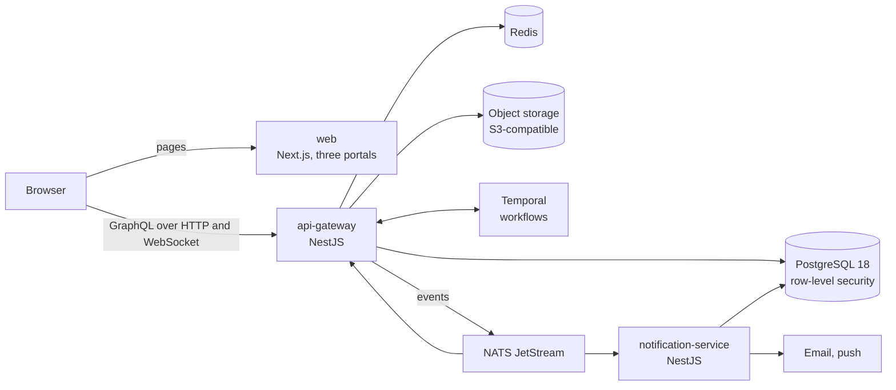

# Architecture

## System overview



- **web** renders the three portals and picks one from the host name. The browser then talks to
  the API directly.
- **api-gateway** is the only public backend. Every request carries a token of one scope
  (platform, reseller or institute) and runs in the database as that scope's role
  ([auth.md](auth.md)). Temporal workers run inside this process.
- **PostgreSQL** holds all institutes in one database and keeps them apart with row-level
  security ([security.md](security.md)).
- **NATS JetStream** carries domain events. The gateway consumes them for the audit log and for
  work that follows a change; **notification-service** consumes them to deliver notifications
  ([guides/events.md](guides/events.md)).
- **Redis** holds short-lived state: cached role abilities, login lockouts, one-time tickets.
- **Object storage** holds uploaded and generated files; the gateway signs a link per file.

## Repository layout

```text
roviq/
├── apps/
│   ├── api-gateway/           # NestJS GraphQL API (the only public backend)
│   ├── notification-service/  # NestJS, consumes NATS events and delivers notifications
│   └── web/                   # Next.js 16, one app for the three portals
├── libs/
│   ├── shared/                # Used by backend and frontend
│   ├── backend/               # NestJS libraries
│   ├── frontend/              # React libraries
│   └── database/              # Drizzle schema, RLS policies, migrations, seeds
├── ee/                        # Enterprise Edition (billing, payment gateways), own licence
├── e2e/                       # API e2e (Vitest) and UI e2e (Playwright) projects
├── tools/                     # Nx projects that own the shared `test:int` and `e2e` targets
├── scripts/                   # Seeds, database reset, instance tooling, the `check:*` gates
├── docker/                    # Compose files and service configuration
├── docs/                      # Start at docs/README.md
└── Tiltfile                   # Dev environment
```

### api-gateway

`apps/api-gateway/src/` has one directory per auth scope, and shared modules beside them:

| Directory | Holds |
|-----------|-------|
| `admin/` | Platform-scope resolvers (`@PlatformScope`) |
| `reseller/` | Reseller-scope resolvers (`@ResellerScope`) |
| `institute/` | Institute-scope resolvers (`@InstituteScope`), one directory per domain (`student/`, `attendance/`, `timetable/`, …) |
| `auth/`, `passkey/` | Login, tokens, impersonation, auth events, passkeys |
| `audit/` | Audit interceptor, consumer and partition workflow (the resolvers live in each scope) |
| `casl/` | Ability guard and module |
| `dlq/` | Dead-letter consumer and service (the resolver lives in `admin/dlq/`) |
| `files/`, `pdf/` | File uploads and scanning, PDF generation |
| `notification-inbox/` | Each scope's in-app inbox, live feed and push device tokens |
| `public-verification/` | Public certificate verification, no login |
| `user-profile/`, `health/`, `common/`, `config/`, `nats/` | Own profile, health checks, shared helpers, configuration, transport wiring |

Enterprise modules live in `ee/apps/api-gateway/src/` and are switched on with `ROVIQ_EE=true`.

### web

```text
apps/web/src/
├── app/[locale]/
│   ├── admin/       # platform portal
│   ├── reseller/    # reseller portal
│   └── institute/   # institute portal
├── components/      # components shared by the portals (docs/frontend.md → "Common components")
└── middleware.ts    # host name → scope (admin.* → /admin, reseller.* → /reseller, else /institute)
```

### Libraries

Every library is imported as `@roviq/<name>`.

| Package | Path | Purpose |
|---------|------|---------|
| `@roviq/common-types` | `libs/shared/common-types` | CASL subjects and actions, `AuthUser`, error codes, event patterns, state machines, date ranges |
| `@roviq/domain` | `libs/shared/domain` | Value objects |
| `@roviq/request-context` | `libs/shared/request-context` | Per-request context (tenant, reseller, user, scope, correlation id) |
| `@roviq/database` | `libs/database` | Drizzle schema, RLS policies, `withTenant` / `withReseller` / `withAdmin`, migrations, seeds |
| `@roviq/auth-backend` | `libs/backend/auth` | Scope guards, JWT strategy, context assertions |
| `@roviq/casl` | `libs/backend/casl` | Ability factory, `AbilityGuard`, `@CheckAbility` |
| `@roviq/audit` | `libs/backend/audit` | Audit decorators and emitter |
| `@roviq/event-bus` | `libs/backend/event-bus` | `EventBusService`: one call publishes to NATS and GraphQL subscriptions |
| `@roviq/nats-jetstream` | `libs/backend/nats-jetstream` | NestJS transport for NATS JetStream |
| `@roviq/pubsub` | `libs/backend/pubsub` | GraphQL subscription pub/sub |
| `@roviq/redis` | `libs/backend/redis` | Redis module and constants |
| `@roviq/storage` | `libs/backend/storage` | S3-compatible object storage |
| `@roviq/temporal` | `libs/backend/temporal` | Temporal client and embedded worker |
| `@roviq/telemetry` | `libs/backend/telemetry` | OpenTelemetry and the Pino logger |
| `@roviq/resilience` | `libs/backend/resilience` | Circuit breaker |
| `@roviq/crypto` | `libs/backend/crypto` | Encrypted fields |
| `@roviq/entitlements` | `libs/backend/entitlements` | Plan entitlement checks |
| `@roviq/groups` | `libs/backend/groups` | Group rule interpreter (JsonLogic) |
| `@roviq/compliance` | `libs/backend/compliance` | Field maps for compliance exports |
| `@roviq/notifications` | `libs/backend/notifications` | Notification types shared by the two backend apps |
| `@roviq/nestjs-graphql` | `libs/backend/nestjs-graphql` | Shared scalars and the paginated type |
| `@roviq/testing` | `libs/backend/testing` | Integration-test harness |
| `@roviq/auth` | `libs/frontend/auth` | React auth context, login, token handling |
| `@roviq/graphql` | `libs/frontend/graphql` | Apollo Client setup, generated types |
| `@roviq/i18n` | `libs/frontend/i18n` | next-intl setup, formatting, form schemas |
| `@roviq/ui` | `libs/frontend/ui` | Components (shadcn/ui), the form kit, the testid registry |
| `@roviq/ee-payments` | `ee/libs/backend/payments` | Payment gateway adapters |
| `@roviq/ee-database` | `ee/libs/database` | Billing schema and seeds |
| `@roviq/ee-billing-types` | `ee/libs/shared/billing-types` | Billing types shared with the frontend |

## HTTP request correlation (ROV-80)

The gateway registers `CorrelationIdMiddleware` globally in `main.ts`, before request
parsing and auth middleware. Global registration also covers paths outside `/api`,
including 404 responses. Each request receives `req.correlationId` and a matching
`x-correlation-id` response header. A non-empty client header is preserved; a missing
or empty header generates a UUID. The `@CorrelationId()` GraphQL parameter decorator
reads the same value. Tenant context and audit consumers use this request value.

## Tech Stack

| Layer     | Technology                                                   |
|-----------|--------------------------------------------------------------|
| Backend   | NestJS 11, GraphQL (Apollo Server 5), Drizzle ORM v1         |
| Frontend  | Next.js 16 (App Router, Turbopack), React 19                 |
| UI        | Tailwind CSS v4, shadcn/ui, Radix UI, next-intl, date-fns    |
| Auth      | JWT (argon2id), Passport, @casl/ability                      |
| Database  | PostgreSQL 18 with Row Level Security                        |
| Cache     | Redis 7 (ioredis)                                            |
| Messaging | NATS 2.10 JetStream                                          |
| Monorepo  | NX 22, pnpm, Biome                                           |
| Testing   | Vitest 4, @nx/vitest                                         |

## Key Design Decisions

### Multi-Tenancy: RLS over Schema-per-Tenant

- PostgreSQL Row Level Security on all tenant-scoped tables
- `app.current_tenant_id` session variable set via `withTenant()` helper
- Policy-based admin bypass: `roviq_admin` does NOT have `BYPASSRLS`. Instead, policies explicitly grant `roviq_admin` access via `FOR ALL USING (true) WITH CHECK (true)`.
- `FORCE ROW LEVEL SECURITY` on every table — without it, the table owner bypasses policies silently.
- `institutes` table has custom RLS: `roviq_app` gets SELECT only (read own institute), `roviq_reseller` gets FOR ALL (GRANTs limit to SELECT + INSERT + UPDATE), `roviq_admin` gets full access.

### Platform vs Tenant Tables

- **Platform-level (custom RLS):** `users`, `institutes`, `institute_groups`, `resellers` — have per-role policies instead of tenant-scoped policies
- **Tenant-scoped (RLS via `tenantPolicies()`):** `memberships`, `profiles`, `roles`, `refresh_tokens`, `student_guardians`, `academic_years`, `standards`, `sections`, `subjects`, `institute_branding`, `institute_configs`, `institute_identifiers`, `institute_affiliations`, `timetables`, `timetable_sections`, `timetable_periods`, `timetable_entries`, `timetable_day_overrides`, and all business data
- Membership links User↔Institute. One user can have memberships in multiple institutes.

### Three DB Contexts

- **`withTenant(db, tenantId, fn)`**: sets `SET LOCAL ROLE roviq_app` + `app.current_tenant_id`. Used for institute-scope operations.
- **`withReseller(db, resellerId, fn)`**: sets `SET LOCAL ROLE roviq_reseller` + `app.current_reseller_id`. Used for reseller-scope operations.
- **`withAdmin(db, fn)`**: sets `SET LOCAL ROLE roviq_admin`. Used for platform admin operations and cross-tenant queries.
- `withTrash` no longer exists — soft-delete visibility moved to the application layer (see "Soft-Delete via Live Views" below).

### Soft-Delete via Live Views

- Every soft-deletable table (every table that spreads `tenantColumns` / `entityColumns`) has a corresponding `<table>_live` PostgreSQL view created `WITH (security_invoker = true)`. The view body is `SELECT * FROM <table> WHERE deleted_at IS NULL`.
- `security_invoker` is critical: it makes the view evaluate RLS as the **calling** DB role (`roviq_app`/`roviq_reseller`/`roviq_admin`) instead of the view owner. Without it, an `roviq_app` connection would read every tenant's rows because RLS would evaluate as the owner. PG 15+ supports it; PG 18 inlines the view with the underlying partial index for free.
- Views are declared in `libs/database/src/schema/live-views.ts` via `pgView('<table>_live').as((qb) => qb.select().from(<table>).where(isNull(<table>.deletedAt)))` and exported as `<table>Live` (e.g. `subjectsLive`, `studentProfilesLive`).
- **Read** through the view: `tx.select().from(subjectsLive)`. **Write** to the base table: `tx.insert(subjects)…`, `tx.update(subjects)…`, `softDelete(tx, subjects, id)`.
- RLS policies are now **tenant-only** (`tenantPolicies()` and `entityPolicies()` no longer carry `deleted_at IS NULL`). The previous `*_app_select_trash` policies and `app.include_deleted` toggle were removed; their behaviour collapses into "query the base table directly with `isNotNull(deletedAt)`" for trash listings.
- CI guard: `pnpm check:live-views` (script at `scripts/check-live-views.ts`) fails when application code reads a soft-deletable base table (`.from()` or a join) outside `__tests__/`; its table list is derived from the `*Live` exports. Annotate intentional admin/break-glass cases with `// allow-base-read: <reason>`.
- Schema-side CI guards: `pnpm check:live-views-coverage` (`scripts/check-live-views-coverage.ts`) walks every `pgTable` in `libs/database/src/schema/` and `ee/libs/database/src/schema/` and fails when a soft-deletable table (spreads `tenantColumns`/`entityColumns` or declares `deletedAt:`) has no matching `<table>Live` export in `live-views.ts`. `pnpm check:rls-coverage` (`scripts/check-rls-coverage.ts`) fails when a `pgTable` definition lacks any RLS indicator (`tenantPolicies`/`entityPolicies`/`pgPolicy` + `.enableRLS()`). Its exemption set `RLS_EXEMPT_BASENAMES` is empty, and adding a table to it needs a security review first. `group_memberships` is `roviq_admin`-only: one admin policy, no table privilege for `roviq_app` or `roviq_reseller` (ROV-90). Personal-data tables keyed by `user_id` (`user_profiles`, `user_identifiers`, `user_documents`, `user_addresses`, `phone_numbers`) use `userScopedPolicies()`: readable only where the user holds a membership in the current tenant (or, for a reseller, in its institutes or on its team), writable only by `roviq_admin`. `users` has the same two read rules on `id`, and `roviq_app` and `roviq_reseller` hold column grants that leave out `password_hash` and `token_version`; `users_live` therefore selects neither column, and the platform code that needs them reads `users` with `deleted_at IS NULL`. `auth_providers` (passkeys) is `roviq_admin`-only. Because an institute reads only its own members, the audit log of an institute or reseller shows a platform or reseller actor who is not a member by their side ("Roviq platform", "Reseller") instead of a name.

### CASL Authorization

- Role abilities stored as JSON in the `roles` table, cached in Redis (5min TTL)
- Per-membership ability overrides in `memberships.abilities` field
- Condition placeholders (`${user.id}`, `${user.tenantId}`) resolved at request time
- Same `AppAction`/`AppSubject` types shared between backend and frontend via `@roviq/common-types`

### NestJS Build: @nx/js:tsc (not webpack)

- NestJS apps use `@nx/js:tsc` executor for builds
- Next.js apps use Turbopack via `@nx/next/plugin`
- No webpack anywhere in the workspace

### GraphQL Schema: In-Memory

- `autoSchemaFile: true` — schema generated in memory, no file written to disk
- Avoids file watcher loops with NX dev server

### Event Architecture

- **EventBusService**: publishes to both NATS JetStream (for cross-service) and GraphQL PubSub (for subscriptions) in a single `emit()` call
- **GraphQL Subscriptions**: 8 subscriptions across 3 scopes with tenant/reseller filtering via `graphql-ws`
- **Temporal**: used for long-running workflows (institute setup pipeline, audit partition management)
- **JetStream consumers**: `apps/notification-service` consumes the `NOTIFICATION` stream; `apps/api-gateway` connects `JetStreamServer` too and consumes `ACADEMIC_YEAR.activated`, `SECTION.deleted`, `STUDENT.*` and `GROUP.rules_updated` for the student year rollover and group invalidation (durables `gateway-<subject>`). Subject list and rules: `docs/guides/events.md` → "api-gateway consumers".
- **JetStream retention**: every business stream uses `workqueue` retention so each message is dispatched to exactly one durable handler. The `NOTIFICATION` stream is the single exception — it uses `interest` retention because workqueue retention rejects overlapping consumer filters. `interest` fans out to every bound consumer and retains each message until all have acked. Stream config lives in `libs/backend/nats-jetstream/src/streams/stream.config.ts`.

### Service Layer Rules

- Services ONLY talk to repositories — never import `DRIZZLE_DB`, `withAdmin`, or Drizzle tables
- Services return repository `Record` types — GraphQL handles mapping via `@ObjectType` decorators
- Each status transition is a named domain mutation (`suspend()`, not `updateStatus('SUSPENDED')`)
- `BusinessException` with `ErrorCode` enum for all business errors (not generic `BadRequestException`)

### Error Handling (ROV-83)

Every GraphQL error reaches the client as `{ message, extensions: { code, statusCode } }` — nothing else. No `originalError`; a `stacktrace` only when `NODE_ENV=development`.

- **Codes** live in `ErrorCode` (`libs/shared/common-types/src/lib/error-codes.ts`); `ERROR_STATUS` maps each to one HTTP status. Throw `new BusinessException(ErrorCode.X, message)`. The message is English and for logs/developers — the frontend translates the code.
- **`GraphqlExceptionFilter`** (`apps/api-gateway/src/common/filters/`, registered as `APP_FILTER`) converts whatever a guard, pipe, interceptor or resolver throws into that shape, on HTTP and graphql-ws alike. Non-GraphQL routes keep Nest's default HTTP error body.
- **`createGraphqlErrorFormatter`** (Apollo `formatError`) is the last stop for errors that never pass a Nest filter — field resolvers and field middleware. Request-level errors from graphql-js / Apollo (`GRAPHQL_VALIDATION_FAILED`, `GRAPHQL_PARSE_FAILED`, `BAD_USER_INPUT`) keep their own code and carry no `statusCode`.
- **Code resolution**: `BusinessException.code`; a plain Nest `HttpException` (framework-thrown, e.g. the throttler) falls back to its HTTP status (`400 BAD_REQUEST`, `401 UNAUTHENTICATED`, `403 FORBIDDEN`, `404 NOT_FOUND`, `409 CONFLICT`, `422 UNPROCESSABLE_ENTITY`, `429 TOO_MANY_REQUESTS`).
- **Anything that is not an `HttpException`** is a server fault: the client gets `INTERNAL_ERROR` / "Internal server error", and the real error is logged at `error` level with the request's correlation ID. A third-party library that rejects on bad client input (e.g. `@simplewebauthn/server` on a challenge mismatch) must be translated to a coded 4xx at the call site.
- **DTO validation** fails as `VALIDATION_FAILED` with the validator messages joined by `; ` (`validationExceptionFactory`, shared by `main.ts` and the integration harness).
- **`UNAUTHENTICATED` and `SESSION_EXPIRED` are the only codes that make the Apollo client refresh the session** (`libs/frontend/graphql/src/lib/client.ts`). Do not reuse them for anything else.

### Field Resolver Pattern: scope-specific joins without duplicating ObjectTypes

When a query in one scope (e.g., admin) needs extra joined fields on a shared `@ObjectType` (e.g., `InstituteModel`), use a scope-specific `@ResolveField` resolver class instead of creating a parallel `AdminInstituteModel`. This avoids duplicating the full ObjectType while keeping cross-scope contamination impossible.

**Two resolver layers on `InstituteModel`:**

- **`InstituteFieldResolver`** — `@UseGuards(GqlAuthGuard)`, all authenticated scopes. Exposes lazy join fields: `branding`, `config`, `identifiers`, `affiliations`.
- **`AdminInstituteFieldResolver`** — `@UseGuards(GqlAuthGuard, PlatformScopeGuard)`, platform admin only. Exposes `resellerName` and `groupName`, batched via DataLoader to eliminate N+1.

**N+1 protection via request-scoped DataLoader:**

`AdminInstituteLoaders` is registered as `@Injectable({ scope: Scope.REQUEST })`. A new instance is constructed per GraphQL request; all `.load(id)` calls within the same request batch into at most 2 extra DB round-trips regardless of page size.

```text
AdminInstituteFieldResolver
  └─ injects AdminInstituteLoaders (Scope.REQUEST)
       ├─ resellerName DataLoader → SELECT id, name FROM resellers WHERE id = ANY($1)
       └─ groupName   DataLoader → SELECT id, name FROM institute_groups WHERE id = ANY($1)
```

**Rule:** Field-only resolver classes (no `@Query`/`@Mutation`/`@Subscription`) are exempt from the scope-guard meta-test — they inherit auth from the parent query. The meta-test uses `declaresRootOperations()` to distinguish them from root resolvers.

### Per-role primary nav

The bottom tab bar and per-portal `defaultSlugs` fallback (see
[frontend.md](frontend.md#responsive-layout--bottom-tab-bar)) are backed by a
small GraphQL surface owned by the Identity Service module group:

- **`Role.primaryNavSlugs: [String!]!`** — curated symbolic slugs for the role.
  Empty list means "use the portal's `defaultSlugs`".
- **`me.primaryNavSlugs: [String!]`** — convenience field on the auth payload;
  resolves to the active membership's role's `primaryNavSlugs` so the web app
  can build the bottom tab bar without a second round-trip.
- **`instituteRoles: [Role!]!`** — `@InstituteScope`, CASL `read Role`. Lists
  all roles in the current tenant for the customization UI.
- **`updateRolePrimaryNav(input: { roleId, slugs }): Role!`** — `@InstituteScope`,
  CASL `update Role`. Validates `slugs.length <= MAX_PRIMARY_NAV_SLUGS` (4),
  uniqueness, and that every entry is a member of `NAV_SLUGS` (from
  `@roviq/common-types`).

Storage is `roles.primary_nav_slugs jsonb` (default `'[]'::jsonb`); the column
was added in migration `20260429031547_stormy_dragon_lord`. Decoupling the
persisted slug from the route/icon/label keeps URL refactors out of the DB —
a renamed page only updates the per-portal `navRegistry`.

### Institute Service

See `docs/features/institutes.md` for full documentation of the institute module including schema, resolvers, RLS, events, and Temporal workflow.

### Attendance, Leaves & Holidays

See `docs/features/attendance.md` for the full attendance + leaves + holidays pipeline — schema, RLS, modules, GraphQL surface, events, integrations, the permissions matrix, and the same-day edit window / admin override semantics.

### Timetable

See `docs/features/timetable.md` for the timetable feature — the 5-table normalized model (`timetables`, `timetable_sections`, `timetable_periods`, `timetable_entries`, `timetable_day_overrides`), single-active + teacher-double-booking partial-unique backstops, the period-grid generation algorithm, named status transitions, conflict detection, and the per-date override model that replaces daily snapshots.

### Examinations & Report Cards

See `docs/features/examinations.md` for the offline-examination feature — the 12-table model (grade schemes + bands, exam terms, exams, datesheet, marks, NEP subject topics + topic assessments, co-scholastic areas + assessments, report-card templates + per-student instances), the `EXAM` / `REPORT_CARD` state machines, pure grading/aggregation math (weighted term percentage, GPA, dense ranking), the GraphQL surface with granular CASL, and the server-rendered report-card PDF.

## Notifications

- Domain events on the `NOTIFICATION` stream are consumed by `apps/notification-service`, which writes the in-app row to PostgreSQL and sends through the channel adapters (`smtp` for email, `fcm` for push, `cloud` for WhatsApp, `http` for SMS).
- An SMS is a registered template: its id and variable values, never free text. Settings and rules: `docs/deployment.md` → "SMS".
- A WhatsApp message goes through a sender (`messaging_senders`: the institute's own number, else the platform's) and an approved template; the provider's webhook (`/webhooks/whatsapp` on the notification service) records delivery reports and stop requests. Rules and settings: `docs/deployment.md` → "WhatsApp alerts".
- Failover inside a channel: a channel may list several providers, first choice first. When one cannot send now (unreachable, rate limited, sender or account blocked) the same attempt goes to the next; a refusal of the message or the recipient does not move on. On WhatsApp the move is from an institute's own sender to the platform's. Either way the attempt writes one delivery row, naming the provider and sender that sent it, or the last one tried. Each error code's class is in `apps/notification-service/src/delivery/adapters/adapter-errors.ts`; settings: `docs/deployment.md` → "Notification delivery". A flow (below) moves between channels when a message did not arrive.
- Rate limit (`delivery/rate/sender-rate-limiter.ts`): each WhatsApp sender sends at most its `messages_per_second` in any one second, counted in Redis by one Lua script, so every notification-service instance shares the count. One sender messages one person at most once in 6 seconds, and a digest leaves 30% of each second to other messages. A message without a free slot waits (`DEFERRED`, `rate_limited`). When the provider answers "too many", the sender pauses for its `Retry-After`, or without one its rate halves and doubles back every 5 minutes.
- Circuit breaker (`delivery/rate/provider-breaker.ts`), in Redis, one per WhatsApp sender and one per channel provider: 5 failures that mean "cannot send now" within 60 seconds open it; after 60 seconds one probe goes through and its answer closes or reopens it. While a breaker is open nothing is sent through it: the attempt moves to the next provider, or for an institute's own sender to the platform's, else it waits (`DEFERRED`, `provider_paused`). A blocked sender or account opens it at once, and a blocked WhatsApp sender is also set `BLOCKED`; the platform admin's activate clears its breaker and throttle. Held messages retry for about 8 hours (`MAX_HELD_DEFERRALS`) before the flow gives up on the channel.
- Regular notification types run through Temporal workflows (flow and digest, queue `notifications`).
- Each regular type declares a flow (`types/flow.ts`: `step.app`, `step.channel`, `step.parallel`, `step.delay`, `step.forEachRecipient`, `waitForArrival`, `onlyIf`). One workflow, `NotificationFlowWorkflow`, walks any flow (`workflows/flow-runner.ts`); no type has workflow code of its own. A step that sent nothing moves on at once; a step that sent waits its time for proof of arrival, and the flow ends as soon as anyone is reached. Channels and recipients not tried are recorded `SKIPPED` / `not_needed`.
- An alert about a student goes to its guardians in a fixed order (`RecipientResolver.guardiansOfStudent`): a guardian who is active staff of the institute, then the primary contact, then the others by earliest link. The app step (in-app copy and push) goes to all of them and waits 30 minutes; then WhatsApp (15 minutes) and SMS (5 minutes) go to the first guardian, and to the second only when the first was not reached. Email is not part of a guardian's flow.
- Proof of arrival: a delivery report from the WhatsApp or SMS provider, the recipient reading or archiving the in-app copy, or the device acknowledging the push (`acknowledgeNotificationDelivery`; the web service worker relays it to an open page). Each is signalled to the flow's workflow, whose id is stored as `flow_id` on the in-app row and on every delivery row. The workflow input holds user ids only.
- A digest summary runs the same flow for its one recipient; it has no fallback to another guardian.
- A critical type (account security, billing) never waits for arrival: its channels go out at once. Reading or acknowledging an alert in the app, which a stolen session could do, therefore cannot stop the email about it (a unit test refuses a critical type whose flow has a wait or a delay).
- Codes and passwords are sent inline by `dispatchSecret` and stored nowhere.
- `notification_deliveries` is append-only: each attempt, report and hold adds a row. A message held by quiet hours, a full sender, the rate limit or an open breaker writes one `DEFERRED` row (`skip_reason` `quiet_hours`, `sender_cap`, `rate_limited` or `provider_paused`) however often the flow retries it. A WhatsApp read report adds a `READ` row, preceded by a `DELIVERED` row when no delivery report came first; a message gets one `DELIVERED` row and one arrival signal whichever report brings it.
- Institutes read their own log through `notificationDeliveryLog` (`apps/api-gateway/src/institute/notification-delivery/`, ability `read NotificationDelivery`): one entry per message and recipient, grouped by the in-app notification, else the flow, else the provider's message id. Each channel shows `READ` or `DELIVERED` when any row says so, else the latest row's status, with `DEFERRED` shown as `WAITING`. Modules and critical types come from `NOTIFICATION_MODULE_OF` and `CRITICAL_NOTIFICATION_TYPES` in `@roviq/common-types`. The log never returns addresses, provider message ids, sender ids or flow ids. Platform support reads raw rows through `adminNotificationDeliveries`.
- The delivery canary (ROV-329) checks the whole path: a Temporal schedule starts `DeliveryCanaryWorkflow` every 15 minutes, which emits `NOTIFICATION.canary.requested` per configured channel; `CanaryListener` sends a `DELIVERY_CANARY` message (module `PLATFORM`, platform audience, no in-app row) through `ChannelSender` to a fixed address. Each SENT moves the gauge `notification_canary_last_success`, and an alert fires when it stops moving. Settings: `docs/deployment.md` → "Delivery canary and alerts".
- The gateway serves the inbox API and the live feed from `apps/api-gateway/src/notification-inbox/`.
- The web app shows them in the bell, `apps/web/src/components/notifications/`.
- Per-institute channel choices live in `institute_notification_configs`.

## File storage

Every stored file is a row in `files` plus an object in S3-compatible storage. Domain tables
reference `files.id`; no table stores a URL. Design and remaining work: Linear ROV-210.

| Topic | Decision |
|---|---|
| Buckets | Two, split by visibility: `S3_BUCKET_PRIVATE` and `S3_BUCKET_PUBLIC`. Owners are key prefixes (`institutes/{tenantId}/{purpose}/{fileId}.{ext}`), never separate buckets. |
| Tenant isolation | RLS on `files` (`filePolicies`). Nobody gets storage credentials; the gateway signs a URL for one exact key after reading the row under RLS. |
| What a purpose allows | `FILE_PURPOSE_POLICY` in `@roviq/common-types`: allowed types, size limit, visibility, sensitivity, and the abilities needed to upload and to download. Adding a file feature starts with a new `FilePurpose`. |
| Upload | `requestFileUpload` inserts a `PENDING` row and returns a presigned PUT (5 minutes). Content type and exact size are signed, so storage itself rejects a different body. The browser uploads straight to storage. |
| Attach | The mutation that owns the record takes `fileIds`. Its service calls `FileService.verifyUploads`, which copies the upload from its `pending/…` key (always in the private bucket) to the key it is served from and checks that copy (size, leading bytes). No upload URL exists for the served key, so a verified file cannot be overwritten. Then its repository calls `markFilesReady(tx, …)` inside the transaction that saves the record. A file is `READY` only together with that record. |
| Download | GraphQL returns `FileRef { id name contentType sizeBytes url }`. `url` is signed when the response is built (10 minutes) and is null for sensitive purposes, which use the `fileDownloadUrl` mutation instead (60 seconds, audited like every mutation). `fileDownloadUrl` checks the ability against the record the file is attached to (for example the leave), not only the subject type. |
| Images | An uploaded JPEG, PNG or WebP is never stored as sent. `ImageProcessor` (sharp) checks the real format and a 50-megapixel limit, decodes the upload once, turns the picture upright, drops all metadata (GPS included) and writes three WebP sizes: `SM` 128 px, `MD` 512 px and `FULL` (per purpose, `FILE_PURPOSE_POLICY[…].image`). Keys are `…/{fileId}/sm.webp` etc. The row keeps `width`, `height`, `variants` and a tiny blurred `placeholder`; `size_bytes` is the sum of the stored sizes. At most two images are processed at once. |
| Image links | `FileRef.url(variant: SM \| MD \| FULL)`. Links live 10 minutes. A purpose may opt in to cacheable thumbnails (`image.cacheableThumbnails`, for avatars and similar): its `SM` and `MD` links are then signed at the start of a 6-hour window and live 12 hours, so every request in a window gets the same URL and browsers cache it. The cost is that a leaked thumbnail link works for up to 12 hours, so scans of documents never opt in. Private objects carry `Cache-Control: private, max-age=43200, immutable`; public ones `public, max-age=31536000, immutable`. |
| Browser side | `prepareImage` scales a picked image down to 2560 px and re-encodes it before upload (a 16.6 MB photo left the browser as 611 KB in testing), so users may pick photos up to 50 MB. `<FileUpload crop="square">` adds a crop step. `<StoredImage>` shows the placeholder first and keeps the image's shape. |
| Files about a person | A purpose with `owner: 'USER'` (today `PROFILE_PHOTO`) is uploaded about a person: `subject_user_id` is set, the key is `users/{userId}/{purpose}/…`, and `tenant_id` is null while the upload is pending. `requestFileUpload` needs `subjectUserId` and refuses a user who is not a member of the caller's institute. A person has two pictures (ROV-292). The institute's picture is set with `setStudentPhoto` / `setStaffPhoto` / `setGuardianPhoto` (ability `update` on that record): it is stored on `tenant_user_profiles.profile_image_file_id`, and attaching it sets the file's `tenant_id`, so from then on RLS shows the file to that institute only. The account picture is set with `setMyProfilePhoto`: it is stored on `user_profiles.profile_image_file_id`, the file stays without an institute, and the platform and reseller portals show it. The replaced file is deleted in the same transaction. Models expose either one as `profileImage: FileRef`, loaded in one query per request by `FileLoaders`. |
| Files of a reseller | A purpose with `owner: 'RESELLER'` (`RESELLER_LOGO`, `RESELLER_FAVICON`) belongs to the reseller: `reseller_id` is set, the key is `resellers/{resellerId}/{purpose}/…`, and it is uploaded through `resellerRequestFileUpload` from the reseller portal only. Both are public, so their links are stable and need no signature. `FileRepository` runs as the caller's role in either scope. |
| Institute branding | `institute_branding.logo_file_id`, `favicon_file_id` and `cover_image_file_id` point at `files` (purposes `INSTITUTE_LOGO`, `INSTITUTE_FAVICON`, `INSTITUTE_COVER`: public, owned by the institute, uploaded with the `update_branding` ability). `updateInstituteBranding` takes the file ids: leave one out to keep the image, send null to remove it, send an id to replace it. The new file becomes READY and the replaced one is deleted in the same transaction as the branding row. `InstituteBrandingModel` exposes them as `logo`, `favicon` and `coverImage` (`FileRef`). The institute picker at login shows the logo: `instituteLogoUrl` on a membership is the public link of the 512 px size. `institutes.logo_url` no longer exists. `institute_group_branding` has `logo_file_id` and `favicon_file_id` for the same purposes; nothing reads or writes them yet. |
| Sensitive files | A purpose with `sensitive: true` (today `USER_DOCUMENT` and `APPLICATION_DOCUMENT`, scans of identity and academic documents) never carries a link in a list: `FileRef.url` is null. Each download asks for a 60-second link through a mutation, so it is audited with the file id: `fileDownloadUrl` in the institute portal, `adminUserDocumentDownloadUrl` in the platform portal. `fileDownloadUrl` checks the record behind the file: for a user document, a student of this institute whom the caller may read, plus the Aadhaar field rule for an Aadhaar scan. It is the one mutation besides `endImpersonation` that a view-only impersonation session may call, because it changes nothing. A document's pages are rows in `user_document_files` (ordered, one file per page, written only as `roviq_admin`). `deleteStudentDocument` removes a student document with the same checks as upload plus the read and Aadhaar rules of the list (any miss answers `STUDENT_NOT_FOUND`): in one transaction the document and its pages are soft-deleted and their files marked DELETED, so they enter the 30-day grace period and are then purged from storage by the sweeper. Documents of an admission application work the same way with institute-owned files: `addApplicationDocument` / `removeApplicationDocument` / `listApplicationDocuments`, pages in `application_document_files` (tenant RLS), download allowed only when the caller may read that application, and no changes once the application is ENROLLED, REJECTED, WITHDRAWN or EXPIRED (`APPLICATION_CLOSED`). |
| Files in workflows | A Temporal activity has no request, so it uses `WorkflowFileStore` (`files/workflow-file-store.ts`): `read(tenantId, fileId, purpose)` and `put({ tenantId, fileId, … })`, both running as that institute under RLS. The workflow chooses the id of a file it writes (`uuid4()` from `@temporalio/workflow`), so a retried activity overwrites the same file instead of adding one. A file that is the input of a workflow, not part of a record, is made READY with `FileService.claimUploads` before the workflow starts (bulk student import: `BULK_IMPORT_CSV` in, `BULK_IMPORT_REPORT` out). |
| Delete | `markFilesDeleted(tx, …)` in the same transaction that detaches the file. The row and objects stay for a 30-day grace period, then the file sweeper removes them (see "File sweeper" below). |
| Client library | `@roviq/storage` wraps `@aws-sdk/client-s3`. Application code never calls S3 directly and uses nothing provider-specific; `pnpm storage:check` tests a provider against what the app relies on. `FakeStorageClient` is the in-memory version for unit tests. |

Status flow: `PENDING` → `READY` → `DELETED`, `PENDING` → `REJECTED` when verification fails, or
`PENDING` → `QUARANTINED` when the malware scan finds a threat (`FILE_STATE_MACHINE`).

Storage quota (ROV-302): `requestFileUpload` refuses an institute-owned upload with
`STORAGE_QUOTA_EXCEEDED` when the institute's `READY` bytes, plus the declared size of its
uploads still `PENDING`, plus the new file would pass `maxStorageMb` of its plan
(`EntitlementService.storageLimitBytes`: no limit when EE is off or the plan says `null`,
`DEFAULT_ENTITLEMENTS` when EE is on and the institute has no subscription). Files about
a person (documents, photos; `tenant_id` null) count for every institute that person is a
member of, in full for each, and their upload is refused the same way. Reseller files are not
counted; files the server writes are counted but never refused. Usage is one
indexed `SUM` per upload request, not a cache. `storageUsage` (institute) and
`adminTenantAnalytics.storageUsedBytes` (platform) show the same `READY` sum.

Malware scan (ROV-303): a file that is not an image is read from its pending key and sent to the
`FileScanner` before it is copied to the key it is served from, so nothing unscanned ever sits
there. An infected file becomes `QUARANTINED`: its bytes are deleted, the row is kept (the
sweeper never removes it), and a `FILE.quarantined` event plus a `quarantineFile` audit entry
name the uploader. Without a verdict the request fails with `FILE_SCAN_UNAVAILABLE` and the
file stays `PENDING`. Images are not scanned because only their re-encoded sizes are stored;
files the server writes itself are not scanned. Scanners: `ClamavFileScanner` (clamd `INSTREAM`
over TCP), `EicarFileScanner` outside production, and `DisabledFileScanner`, which is what
production uses until ClamAV is turned on (`docs/deployment.md` → "Malware scanning
of uploads").

### File sweeper

An hourly Temporal job (ROV-300) removes files nobody needs any more, across every institute.
Code: `files/file-sweeper.ts`, queries in `files/file-purge.repository.ts`, workflow in
`files/workflows/`. Only `roviq_admin` may delete a `files` row, so every query runs as that role.

What is removed, and when:

| File | Removed after | Objects deleted |
|---|---|---|
| `PENDING` upload nobody attached | 24 hours from `created_at` | `pending/{key}` (private bucket), the key and its three image sizes |
| `REJECTED` upload | 24 hours from `updated_at` | same as `PENDING` |
| `DELETED` file | 30 days from `deleted_at` (the grace period; a file can be restored by hand until then) | the key and its three image sizes in its own bucket |

Rules:

- Objects first, the row last. A missing object counts as deleted. When storage fails, the row stays
  and the next run tries again.
- A stale `PENDING` upload is first set to `REJECTED`, so a form submitted during the sweep cannot
  attach a file whose object is going. If it was attached first, it is left alone.
- A file that any record still points at is never purged, whatever its status says. The records
  are: a live link row (`leave_files`, `user_document_files`, `application_document_files`), a
  branding column (`institute_branding`, `institute_group_branding`), a profile's photo
  (`user_profiles.profile_image_file_id`, `tenant_user_profiles.profile_image_file_id`), a
  reseller's logo or favicon, and a live staff
  qualification's certificate. Such a file is counted as skipped and its pointer is left as it is.
  Already-deleted link rows are removed with the file; a soft-deleted qualification's pointer is
  set to null when its certificate goes.
- Each run first retires `READY` files that are no longer needed, which marks them `DELETED` and
  starts their grace period. Every `FilePurpose` has a rule in `FILE_RETIREMENT`:
  - `TIMED` (`BULK_IMPORT_CSV`, `BULK_IMPORT_REPORT`): 30 days after it was written.
  - `REFERENCED` (all others): once no record has pointed at it for 24 hours. This is a safety net
    for a code path that dropped a file without marking it deleted.
- A run handles at most 100 files per kind per query and 20 batches per kind; the rest waits for
  the next hour. One log line per run gives the counts. Metric: `file_sweeper_files_total`.

Schedule: `file-sweeper-hourly` (every hour, overlap `SKIP`, catch-up window 1 hour), workflow
`fileSweeper` on task queue `file-maintenance`, one activity `sweepFiles` (10-minute timeout,
3 attempts). A gateway with `FILE_SWEEPER_WORKER_ENABLED=true` runs the worker and creates the
schedule at start if Temporal does not have it.

`FileService.purge(fileIds)` removes files at once, whatever their age, for server workflows such
as a data erasure request. It refuses a file that any record still points at (`inUse`) and reports unknown ids
(`missing`). It must never be reachable from a resolver with ids a user typed.

Frontend: `<FileUpload>` and `useFileUpload()` in `apps/web/src/components/file-upload/`.

## Date & timezone contract

| Layer | Format | Notes |
| --- | --- | --- |
| PostgreSQL storage | `date` (YYYY-MM-DD) / `timestamptz` (RFC 3339 UTC) | Drizzle maps `date` ↔ `string`, `timestamp` ↔ `Date` |
| GraphQL wire | `DateOnly` scalar (YYYY-MM-DD) / `DateTime` scalar (RFC 3339) | `graphql-scalars` `GraphQLLocalDate` / `GraphQLDateTimeISO` |
| Frontend display | Indian locale (DD/MM/YYYY) via `useFormatDate()` from `@roviq/i18n` | Never format in resolvers or services |
| Institute-timezone calendar | `getInstituteToday(institute)` from `apps/api-gateway/src/common/timezone` (API-gateway-internal) | Falls back to `Asia/Kolkata` |

**The DD/MM footgun**: India displays DD/MM/YYYY. ISO stores YYYY-MM-DD. These must never be confused — store ISO, parse ISO, display via hook. A display string must never be re-parsed as a date.

## Audit log

**Platform and reseller actions on an institute (ROV-311).** Such an action is audited in the
platform or reseller scope with `tenant_id` NULL. So that the institute can see it,
`audit_logs.subject_tenant_id` names the institute the action was about, and the
`audit_app_read` policy lets an institute read its own rows and the rows that name it. The
resolver says which argument holds the institute id with `@AuditInstitute('id')` (or
`'input.tenantId'`); a mutation whose arguments do not hold it (a download by file id) calls
`markAuditInstitute(req, id)`. The institute's audit screen marks these rows "Roviq platform" or
"Reseller"; of such a row it gets the actor, the action and the stated reason, not the IP
address, browser, raw arguments or error text. The institute is named from the arguments only
when the action succeeded (a platform admin excepted, who may act on any institute), and a
trigger clears the subject of a reseller row that names an institute of another reseller. A new platform or
reseller mutation that acts on one institute needs the decorator, or the institute will not see
it.
